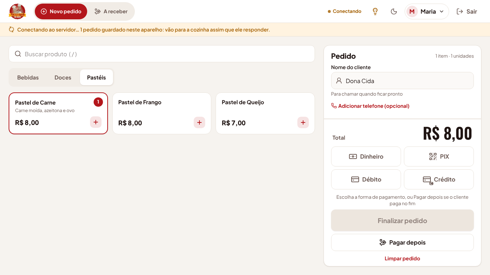
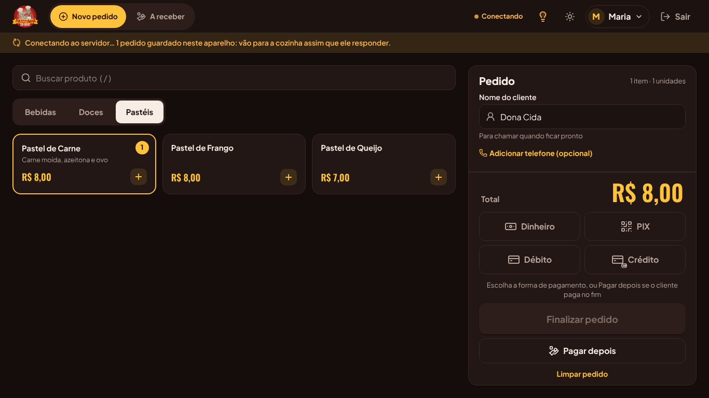
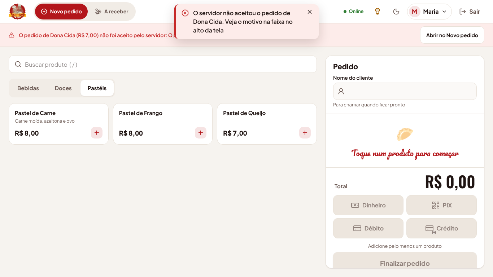
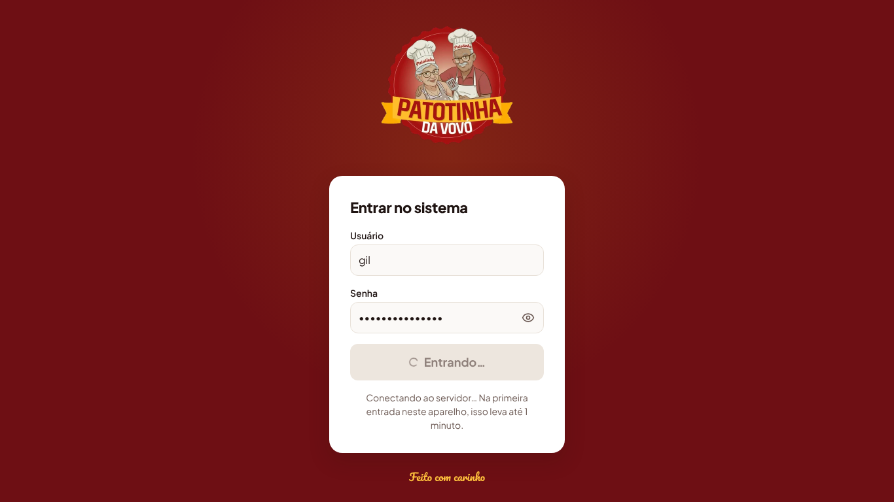
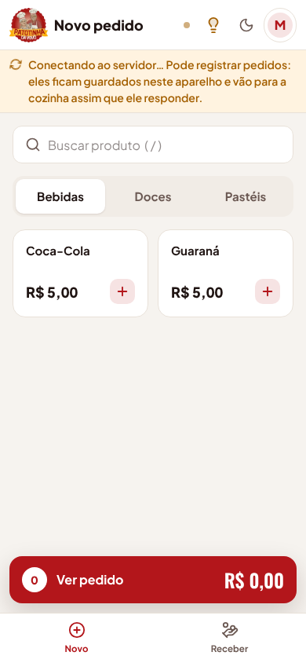

# Abrir sem esperar o servidor (etapa 16)

Adicionado em 08/11/2026, a pedido do Ryan, copiando a solução do Compoze: o sistema abre **na
hora**, mesmo com a API do Render dormindo, e se conecta ao servidor sozinho, em segundo plano.
Acaba a tela "Carregando…" de até 1 minuto da etapa 9.

## Por quê

No plano grátis do Render, a API desliga depois de 15 minutos parada e leva até 1 minuto para
voltar. O site (Static Site) nunca dorme, mas até aqui ele segurava a tela até a API responder
(`EsperarServidor`, etapa 9). No balcão, isso é um minuto parado com cliente na frente.

## Como funciona no balcão

1. **Abrir o sistema.** A tela aparece na hora. Se a pessoa entrou neste aparelho nas últimas 12
   horas, já cai na tela dela (Novo pedido, Fila, Início), sem digitar a senha.
2. **Entrar.** Se a sessão venceu, o login aparece na hora. Quem já entrou **neste aparelho** com
   essa mesma senha entra na hora também: o aparelho confere a senha sozinho e o login de verdade
   acontece em segundo plano quando a API acordar. Quem nunca entrou neste aparelho (ou trocou a
   senha) espera a API, com o aviso "Conectando ao servidor… Na primeira entrada neste aparelho,
   isso leva até 1 minuto."
3. **Enquanto a API acorda**, o ponto do cabeçalho fica amarelo ("Conectando") e uma faixa logo
   abaixo dele avisa: "Conectando ao servidor… Pode registrar pedidos: eles ficam guardados neste
   aparelho e vão para a cozinha assim que ele responder."
4. **Novo pedido funciona normalmente**, com o cardápio guardado no aparelho. Ao finalizar (ou
   tocar em Pagar depois), o pedido fica **guardado no aparelho** ("Pedido de Seu Tonho guardado
   neste aparelho. Vai para a cozinha assim que o servidor conectar") e a tela já fica limpa para
   o próximo cliente. A faixa mostra quantos estão guardados.
5. **Quando a API responde**, os pedidos guardados sobem sozinhos, na ordem em que foram feitos,
   e cada um avisa "Pedido nº 123 de Seu Tonho chegou ao servidor e foi para a cozinha". A faixa
   some. As outras telas (Fila, Histórico, Início, Resumo) carregam sozinhas nessa hora.
6. **Se o servidor recusar um pedido guardado** (o preço mudou, o produto foi desativado), ele
   não some: a faixa fica vermelha com o nome do cliente, o valor e o motivo, e o botão **Abrir no
   Novo pedido** devolve o pedido para a tela, para corrigir e finalizar de novo.

O mesmo vale se a internet do aparelho cair no meio do turno: os pedidos ficam guardados e sobem
quando ela voltar. Antes, finalizar sem conexão dava "O pedido NÃO foi gravado".

## Regras

- RN-O1: o sistema nunca segura a tela esperando a API. Ela é acordada em segundo plano assim que
  a página abre (`/api/vivo`, que não toca no banco), com novas tentativas de 2 em 2 segundos,
  espaçando até 15 segundos. A faixa só aparece se a resposta passar de 2,5 segundos; depois de
  2,5 minutos, o texto muda para "O servidor ainda não respondeu", mas continua tentando.
- RN-O2: **sessão lembrada**: depois de um login aceito pelo servidor, o aparelho lembra quem
  entrou e até quando o cookie vale (12 h, D-21). Dentro desse prazo a tela abre direto e o
  servidor confere a sessão (`/auth/me`) quando responder; se ele recusar, volta ao login com
  "Sua sessão expirou".
- RN-O3: **acesso do aparelho**: depois de um login aceito pelo servidor, o aparelho guarda um
  resumo da senha (PBKDF2-SHA-256, 210 mil rodadas, com sal; **nunca a senha**) e os dados de quem
  entrou, para os 10 últimos usuários do aparelho. Com a API dormindo, a senha digitada é conferida
  com esse resumo. Senha errada ou desconhecida nunca entra sem o servidor. Se o servidor depois
  recusar a senha (trocada em outro aparelho, usuário desativado), o sistema sai e avisa "O
  servidor não aceitou o seu usuário e senha"; o resumo antigo é apagado.
- RN-O4: o perfil e as permissões do acesso do aparelho só escondem telas, como sempre. Quem
  bloqueia é a API: nenhuma consulta ou gravação passa antes do login de verdade.
- RN-O5: **cópia do cardápio**: produtos e categorias ativos, formas de pagamento e o Pix da loja
  ficam guardados no navegador a cada leitura. Pedidos, fila, clientes e relatórios nunca: mudam o
  tempo todo e só aparecem com o servidor.
- RN-O6: **pedidos guardados**: com a API fora, o pedido entra numa fila no navegador
  (`localStorage`) com a mesma chave de idempotência do rascunho. Ao subir, o servidor confere
  tudo (preço, produto ativo, forma de pagamento) como em qualquer pedido; reenviar depois de uma
  queda não grava duas vezes (RN-26). A hora do pedido é a da chegada ao servidor.
- RN-O7: cada pedido guardado é de quem o registrou e só sobe com a sessão dessa pessoa. Sair do
  sistema com pedidos guardados pede confirmação ("Eles só sobem quando você entrar de novo").
- RN-O8: sair com a API dormindo apaga a sessão do aparelho na hora; o cookie é apagado no
  servidor assim que ele acordar, antes de qualquer outra chamada.
- RN-O9: pedido guardado recusado pelo servidor (erro 4xx) fica na faixa com o motivo até alguém
  tocar em **Abrir no Novo pedido**. Erro do próprio servidor (5xx) tenta de novo a cada 20
  segundos.

## Por dentro

| Peça                                            | O que faz                                                                                                                           |
| ----------------------------------------------- | ----------------------------------------------------------------------------------------------------------------------------------- |
| `apps/web/src/api/conexao.ts`                   | Estado da conexão (`conectando`/`conectado`), laço que pergunta a `/api/vivo`, `esperarConexao()` e os preparos (`antesDeConectar`) |
| `apps/web/src/api/copiaLocal.ts`                | Cópia do cardápio no `localStorage`; põe no React Query antes da primeira tela                                                      |
| `apps/web/src/auth/acessoLocal.ts`              | Sessão lembrada e acesso do aparelho (resumo PBKDF2 da senha)                                                                       |
| `apps/web/src/auth/sessao.tsx`                  | Abre com a sessão lembrada; entra pelo acesso do aparelho; faz o login de verdade e o sair pendente antes de liberar a conexão      |
| `apps/web/src/telas/novo-pedido/filaPedidos.ts` | Pedidos guardados no aparelho: guarda, envia em ordem, marca recusa                                                                 |
| `apps/web/src/layout/FaixaConexao.tsx`          | Ponto do cabeçalho, faixa "Conectando", envio dos guardados e pedidos recusados                                                     |
| `apps/web/src/main.tsx`                         | Liga o `onlineManager` do React Query à conexão: sem servidor, as consultas ficam em pausa, sem erro                                |

A ordem quando a API responde: `/api/vivo` ok → sair pendente (`/auth/logout`) → login pendente
(`/auth/login`) → estado `conectado` → consultas voltam e a fila de pedidos sobe. Se um desses
passos cair por falta de conexão, a conexão volta a "conectando" e tenta de novo.

A API não mudou. Ela já aceitava a chave de idempotência e já conferia os preços; a única mudança
é a constante `DURACAO_SESSAO_S` ter ido para `packages/shared`, para o site saber até quando a
sessão vale.

Se o Render devolver a página HTML dele (em vez do JSON da API) enquanto acorda, o cliente da API
trata como falta de conexão, e não como resposta.

## O que mudou da etapa 9

- A tela "Carregando…" (`EsperarServidor`) saiu. O site separado, o repasse de `/api/*` e o
  monitor continuam iguais ([site-separado.md](site-separado.md)).
- O ponto do cabeçalho passou de verde/vermelho para verde/amarelo ("Conectando"): sem servidor o
  sistema continua funcionando, então não é mais um erro.
- Finalizar sem conexão guarda o pedido no aparelho, em vez de "O pedido NÃO foi gravado".
- Mudanças de cadastro (produtos, usuários, Pix), cancelar, receber e marcar pronto continuam
  precisando do servidor: com ele fora, avisam "Não foi possível carregar".

## Segurança

O resumo da senha no aparelho segue a recomendação da OWASP para PBKDF2 (210 mil rodadas de
SHA-256) e usa sal próprio por usuário. Mesmo assim, quem tiver o aparelho destravado e muito tempo
pode tentar adivinhar uma senha fraca a partir dele: por isso as senhas dos funcionários devem ter
pelo menos 8 caracteres (já é a regra do cadastro). Para tirar um aparelho perdido, basta trocar a
senha das pessoas que usavam esse aparelho: o próximo login de verdade é recusado e o sistema sai.

## Testes

`e2e/sem-esperar-servidor.spec.ts` simula a API dormindo (toda chamada a `/api` responde 503 com HTML,
como o Render):

- o login aparece na hora, e a primeira entrada no aparelho espera a API e entra quando ela acorda;
- com a sessão lembrada, a tela abre com o cardápio da cópia, o pedido fica guardado e sobe uma vez
  só quando a API acorda;
- pedido guardado recusado aparece na faixa e volta ao Novo pedido;
- senha errada espera o servidor, que recusa; a senha certa que o aparelho conhece entra na hora,
  e o cookie de sessão chega pelo login feito em segundo plano.

Substitui o `e2e/carregando.spec.ts` da etapa 9.
