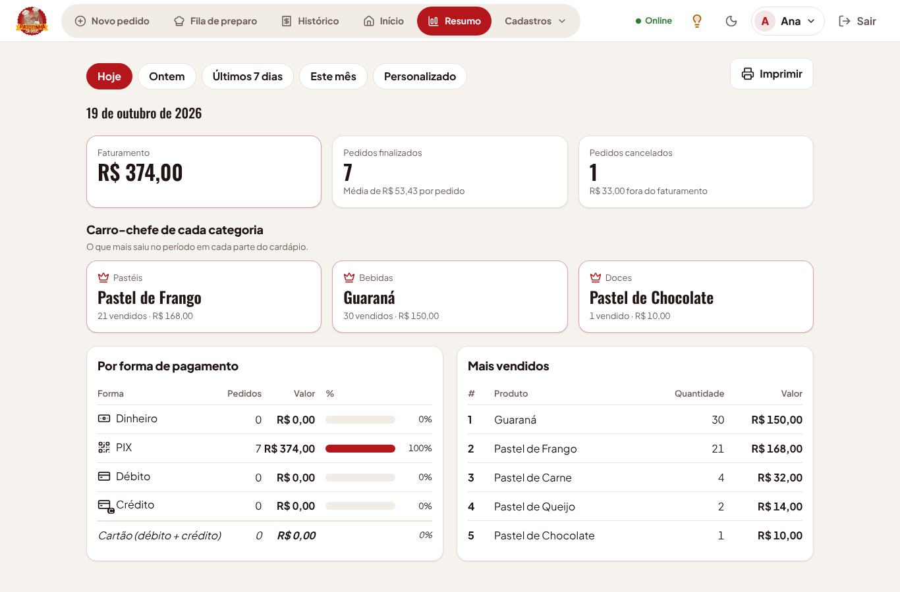
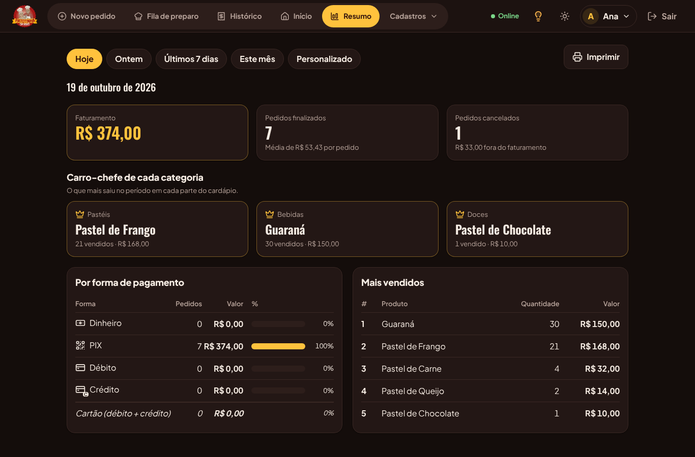
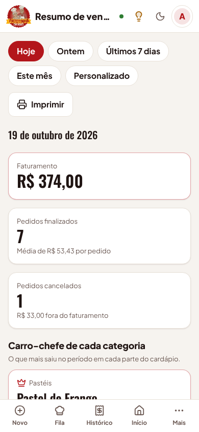

# Carro-chefe no Resumo de vendas (etapa 14)

Adicionado em 19/10/2026, a pedido do Ryan: o **Resumo de vendas** mostra o sabor que mais saiu,
para a lanchonete saber o que está vendendo mais e qual é o carro-chefe.

## Como aparece

Logo abaixo dos cartões de faturamento e pedidos fica a seção **Carro-chefe de cada categoria**:
um cartão com coroa para cada parte do cardápio (Pastéis, Lanches, Bebidas...), com o produto
campeão do período, quantas unidades saíram e quanto rendeu. Exemplo: "Pastéis · Fazenda ·
42 vendidos · R$ 336,00".

É por categoria porque, olhando só a lista geral, o refrigerante em lata costuma ficar na frente
de qualquer pastel. Assim o cartão de **Pastéis** responde direto "qual sabor mais sai". A lista
**Mais vendidos** (os 10 primeiros de tudo) continua logo abaixo.

## Regras

- Vale o período escolhido no alto (hoje, ontem, 7 dias, este mês ou outras datas).
- Conta só pedidos **finalizados**; cancelados ficam de fora, como no resto do Resumo (RN-16).
- Campeão = mais **unidades** vendidas. Empate em unidades: fica o que rendeu mais em reais.
- A categoria é a atual do produto; o nome mostrado é o gravado na venda mais recente.
- Categoria sem venda no período não aparece. Período sem vendas mostra o aviso de sempre.
- Cartões na ordem em que as categorias foram cadastradas (no cardápio oficial: Pastéis,
  Lanches, Bebidas).
- Quem vê: quem tem a permissão **Financeiro** (a mesma da tela Resumo).

## Técnico

- `GET /api/relatorios/vendas` ganhou o campo `maisVendidoPorCategoria`:
  `{ categoriaId, categoria, produtoId, nome, quantidade, valor }[]`. Sem migração de banco.
- Consulta em `apps/api/src/relatorios/rotas.ts` (SQL parametrizado com `DISTINCT ON`).
- Tela em `apps/web/src/telas/Resumo.tsx`; textos em `textos.pt-BR.json` (`resumo.carroChefe`);
  lâmpada da tela atualizada em `apps/web/src/ajuda/conteudo.ts`.
- Testes: `apps/api/test/relatorios.test.ts` (campeão por categoria, cancelados fora, desempate)
  e `e2e/resumo-carro-chefe.spec.ts`.
