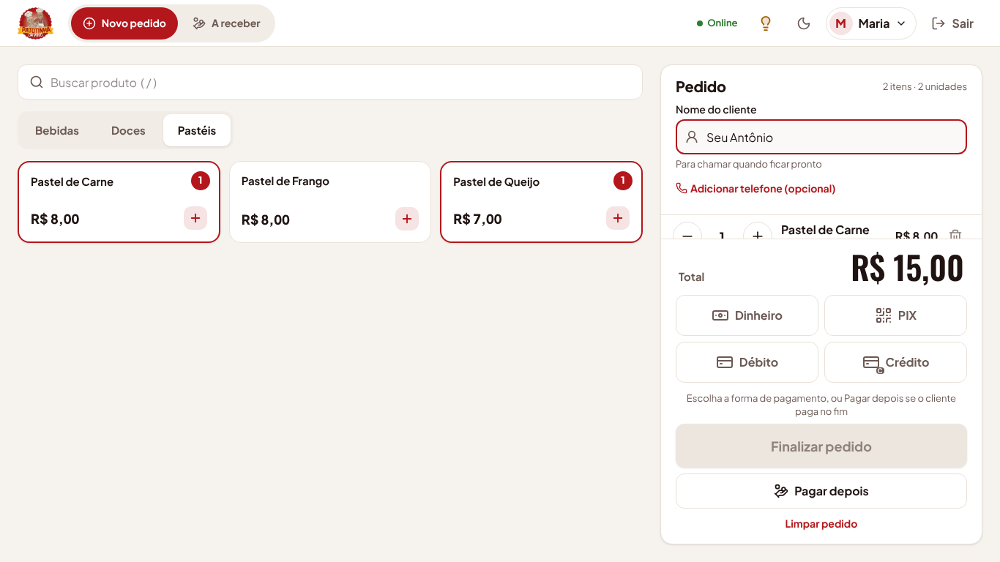
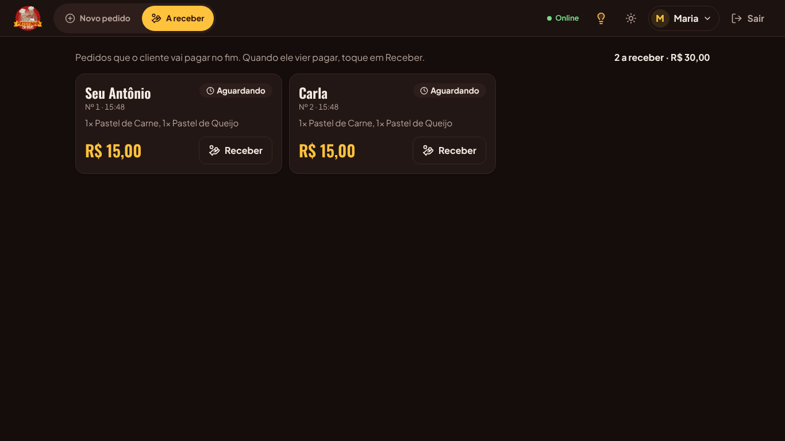
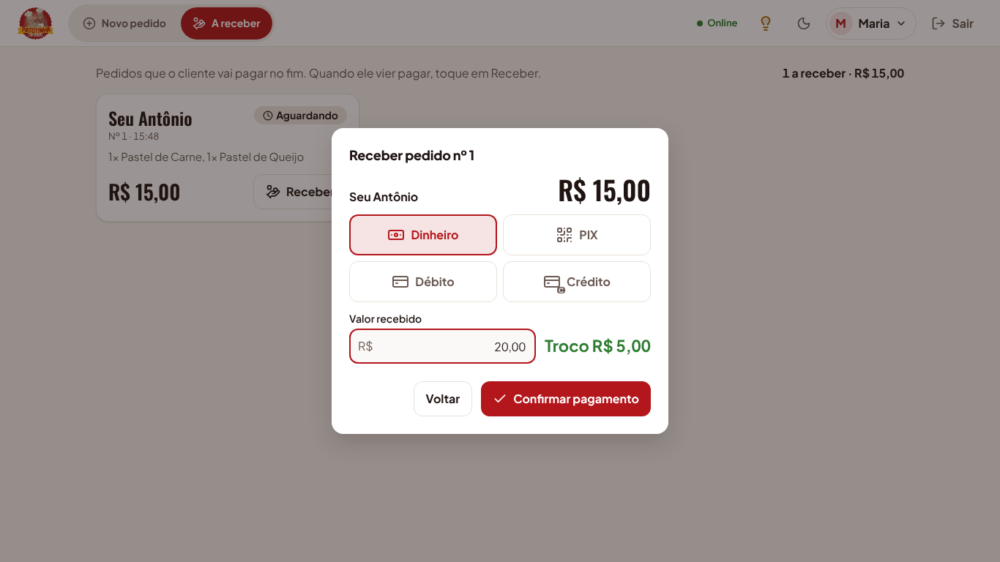
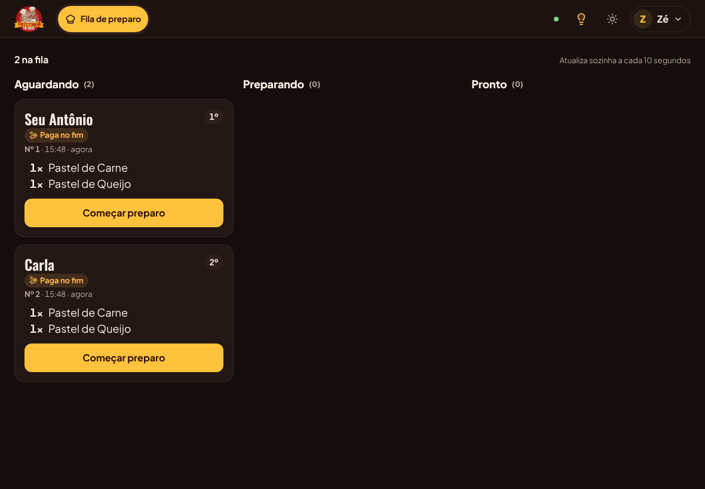
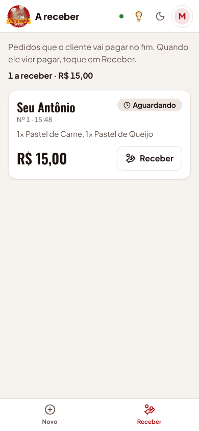

# Pagar depois e tela A receber (etapa 14)

Adicionado em 19/10/2026, a pedido do Ryan: na Patotinha o costume é o cliente pedir, comer e
pagar no fim. O pedido agora pode ir para a cozinha **sem pagamento**, e a cobrança fica para
quando o pastel estiver pronto ou o cliente vier pagar.

## Como funciona no balcão

1. No **Novo pedido**, monte o pedido e escreva o nome do cliente, como sempre.
2. Em vez de escolher a forma de pagamento, toque em **Pagar depois**. O pedido é gravado e vai
   na hora para a **Fila de preparo**, com a etiqueta **Paga no fim** para a cozinha saber.
3. Quando o cliente vier pagar, abra **A receber** (no menu, ao lado do Novo pedido; no celular,
   **Receber** na barra de baixo). A tela mostra os pedidos esperando pagamento, a situação do
   preparo de cada um e a soma de tudo que falta receber. O que já está pronto fica destacado.
4. Toque em **Receber** no pedido, escolha **Dinheiro** (com o valor recebido e o troco),
   **PIX** (o botão mostra o QR Code com o valor do pedido), **Débito** ou **Crédito**, e toque
   em **Confirmar pagamento**.
5. O pedido sai da lista **A receber** e passa a contar nas vendas.

No **Detalhe do pedido** de um pedido a pagar também há **Receber pagamento**. O **Finalizar
pedido** de antes (pagar na hora) continua igual.

## Regras

- RN-D1: **Pagar depois** grava o pedido com situação **A pagar** (status `ABERTO` no banco), sem
  forma de pagamento. Ele entra na fila de preparo como qualquer outro.
- RN-D2: pedido a pagar **não conta nas vendas** (Início, Resumo, totais do Histórico) até ser
  recebido. Ao receber, vira **Finalizado** com a forma, o valor recebido, o troco e a hora do
  pagamento.
- RN-D3: receber duas vezes não é possível: se dois aparelhos tocarem em Confirmar ao mesmo tempo,
  só o primeiro vale e o outro vê "Este pedido já foi pago". Pedido cancelado não pode ser
  recebido.
- RN-D4: quem pode **Registrar pedidos** (Funcionário, Gerente, Administrador) usa o Pagar depois e
  a tela A receber. O Chef vê só a etiqueta **Paga no fim** na fila.
- RN-D5: um pedido a pagar pode ser cancelado por quem tem permissão de cancelar, como os outros.
- RN-D6: o PIX segue as regras do Pix da loja ([pix.md](pix.md)): o sistema não confirma sozinho,
  quem atende confere no app do banco antes de tocar em Confirmar pagamento. O identificador no
  extrato é `PEDIDO<número>`.
- RN-D7: no **Histórico**, o filtro de situação ganhou **A pagar**, para achar pedidos que ficaram
  sem pagamento (por exemplo, de um dia anterior; na lista A receber eles aparecem com a data).

## API

- `POST /api/pedidos` aceita `pagarDepois: true` sem `formaPagamento` nem `valorRecebido`
  (mandar os dois juntos dá 422 `PAGAR_DEPOIS_SEM_PAGAMENTO`).
- `GET /api/pedidos/a-receber`: pedidos a pagar, do mais antigo para o mais novo, com itens,
  total e situação do preparo.
- `PATCH /api/pedidos/:id/pagamento` com `formaPagamento` e `valorRecebido` (só em dinheiro):
  finaliza o pedido. 409 `PEDIDO_JA_PAGO` ou `PEDIDO_CANCELADO` quando não está a pagar.
- A fila (`GET /api/fila`) traz `aPagar: true` nos pedidos que pagam no fim.
- Não houve migração: o banco já permitia pedido `ABERTO` sem forma de pagamento.
