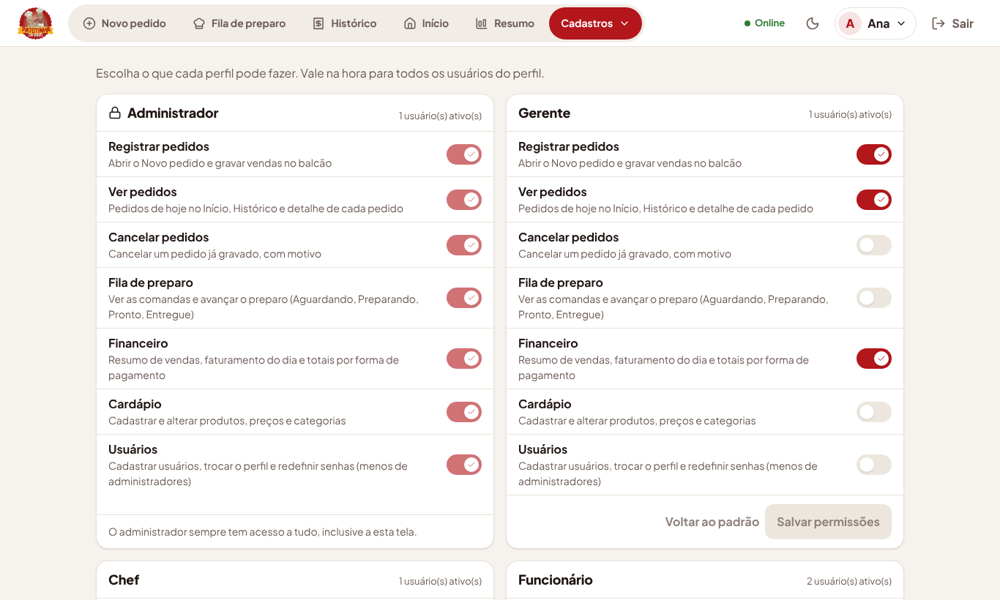
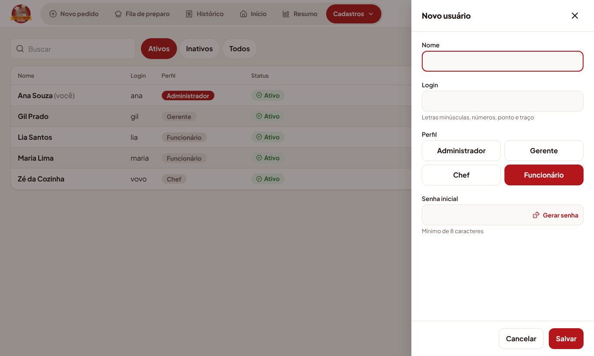
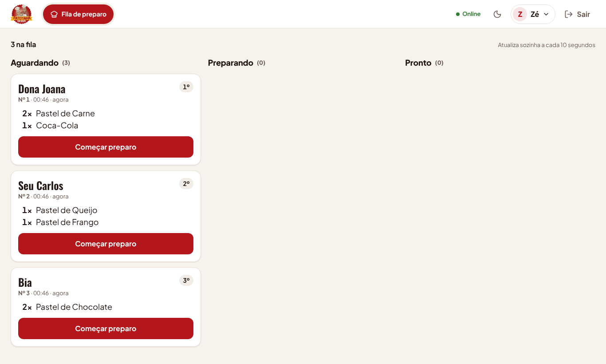
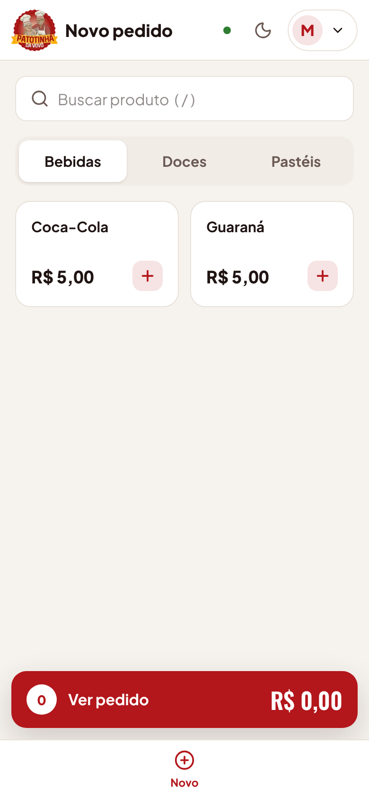

# Perfis de acesso e permissões (etapa 10)

Adicionado em 17/10/2026, a pedido do Ryan: além do Administrador, o sistema passa a ter os
perfis **Gerente**, **Chef** e **Funcionário**, e o administrador escolhe o que cada perfil pode
fazer na tela **Cadastros › Perfis e permissões**.

## Perfis e o que fazem de fábrica

| Permissão         | O que libera                                                                   | Admin | Gerente | Chef | Funcionário |
| ----------------- | ------------------------------------------------------------------------------ | :---: | :-----: | :--: | :---------: |
| Registrar pedidos | Novo pedido (gravar vendas no balcão)                                          |   ✓   |    ✓    |      |      ✓      |
| Ver pedidos       | Pedidos de hoje no Início, Histórico e detalhe do pedido                       |   ✓   |    ✓    |      |             |
| Cancelar pedidos  | Cancelar um pedido gravado, com motivo                                         |   ✓   |         |      |             |
| Fila de preparo   | Ver as comandas e avançar o preparo                                            |   ✓   |         |  ✓   |             |
| Financeiro        | Resumo de vendas, cartões de faturamento do Início, soma em reais no Histórico |   ✓   |    ✓    |      |             |
| Cardápio          | Produtos, preços e categorias                                                  |   ✓   |         |      |             |
| Usuários          | Cadastrar usuários, trocar perfil, redefinir senha                             |   ✓   |         |      |             |

- **Administrador:** sempre pode tudo, inclusive a tela de perfis. Não dá para tirar permissões
  dele, para ninguém trancar o sistema por engano.
- **Gerente:** registra pedidos, vê pedidos e o financeiro.
- **Chef:** só a Fila de preparo (as comandas). Abre direto nela. Vê nome do cliente, itens e
  quantidades; não vê valores.
- **Funcionário:** só registra pedidos. Abre direto no Novo pedido.

## Tela "Perfis e permissões"

- Só o administrador vê (menu **Cadastros**, ou "Mais" no celular).
- Um cartão por perfil, com um botão liga/desliga por permissão, quantos usuários ativos têm o
  perfil, **Voltar ao padrão** (as permissões de fábrica acima) e **Salvar permissões**.
- O cartão do Administrador aparece com tudo ligado e travado.
- Mudou e salvou, vale na hora: a API confere as permissões no banco a cada requisição, sem
  precisar sair e entrar. A tela da pessoa se ajusta ao recarregar ou entrar de novo.

## Regras

- RN-P1: o menu e as telas mostram só o que o perfil pode fazer; quem bloqueia de verdade é a API,
  que responde 403 `SEM_PERMISSAO` ("Seu perfil não tem permissão para isso...").
- RN-P2: a primeira tela depois do login depende do perfil: com Financeiro, Início; senão, com
  Registrar pedidos, Novo pedido; senão, com Fila, a Fila de preparo; senão, com Ver pedidos, o
  Histórico.
- RN-P3: a soma em reais do Histórico só vai para quem tem Financeiro.
- RN-P4: quem tem a permissão Usuários sem ser administrador não cria administrador, não
  promove ninguém a administrador e não altera, desativa nem redefine a senha de um
  administrador (403 `SO_ADMIN`). As regras de sempre continuam: pelo menos um administrador
  ativo e ninguém desativa a si mesmo.
- RN-P5: produtos, categorias e formas de pagamento podem ser lidos por qualquer
  usuário logado (o Novo pedido precisa delas); mudar o cardápio pede a permissão Cardápio.

## Banco de dados

Migração `20261017000000_perfis`:

- Tabela nova `perfis` (`codigo`, `nome`, `permissoes` como lista, `atualizado_em`), com os quatro
  perfis e as permissões de fábrica. Um CHECK só aceita as permissões conhecidas.
- `usuarios.perfil` deixa de ter a lista fixa (`ADMIN`, `FUNCIONARIO`) e passa a apontar para
  `perfis.codigo` (chave estrangeira).
- Os usuários que já existem continuam com o perfil que tinham. Os funcionários antigos passam a
  ter só "Registrar pedidos"; se algum deles deve ver a fila ou o histórico, troque o perfil dele
  ou ligue a permissão no perfil Funcionário.
- A migração roda sozinha na publicação (`prisma migrate deploy` no início da API).

## API

| Método e caminho                     | Quem          | O que faz                                    |
| ------------------------------------ | ------------- | -------------------------------------------- |
| `GET /api/perfis`                    | Administrador | Os quatro perfis, com permissões e usuários  |
| `PUT /api/perfis/:codigo/permissoes` | Administrador | Troca a lista de permissões (`ADMIN` é fixo) |

`POST /api/auth/login` e `GET /api/auth/me` devolvem também `permissoes` do usuário.

Permissão exigida por rota: `POST /pedidos` Registrar; `GET /pedidos` e `GET /pedidos/:id` Ver
pedidos; `PATCH /pedidos/:id/cancelar` Cancelar; `GET /fila` e `PATCH /pedidos/:id/preparo` Fila;
`GET /relatorios/vendas` Financeiro; escritas em `/produtos` e `/categorias` Cardápio; `/usuarios`
Usuários.

## Testes

- API: `apps/api/test/perfis.test.ts` (permissões de fábrica por perfil, tela de perfis, mudança
  valendo na hora, Administrador fixo, gerente com Usuários não mexe em administrador).
- Ponta a ponta: `e2e/fluxo-principal.spec.ts` (Funcionário só vê Novo pedido, Gerente vê o
  histórico, Chef cuida da fila) e `e2e/perfis.spec.ts` (admin libera e devolve uma permissão).

## Telas (dados fictícios)

| Perfis e permissões                    | Novo usuário com os quatro perfis                    |
| -------------------------------------- | ---------------------------------------------------- |
|   |     |
| **Chef: só a fila**                    | **Funcionário no celular: só Novo pedido**           |
|  |  |
