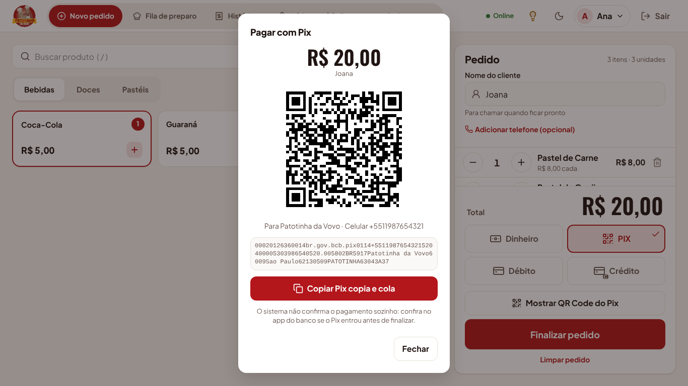
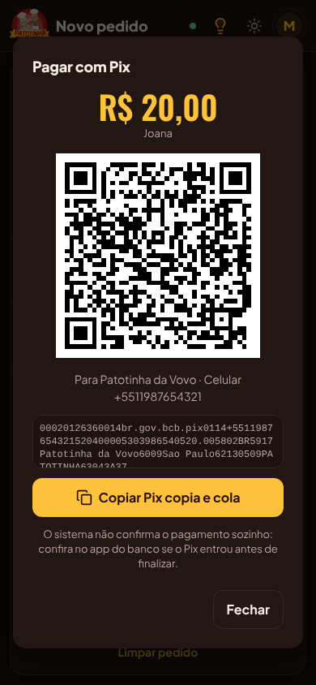
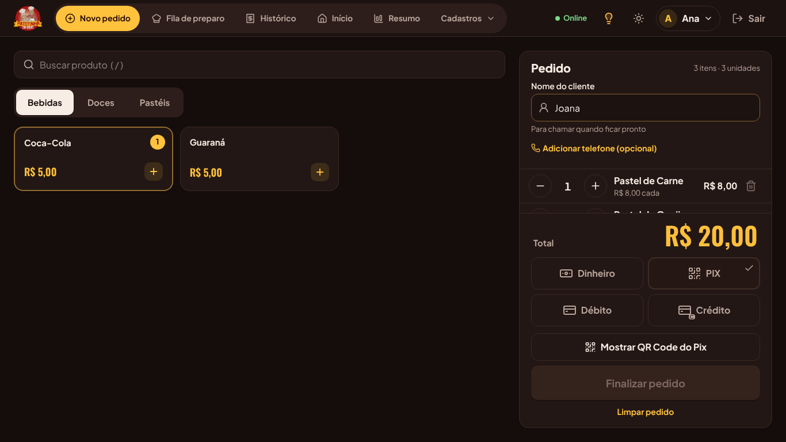
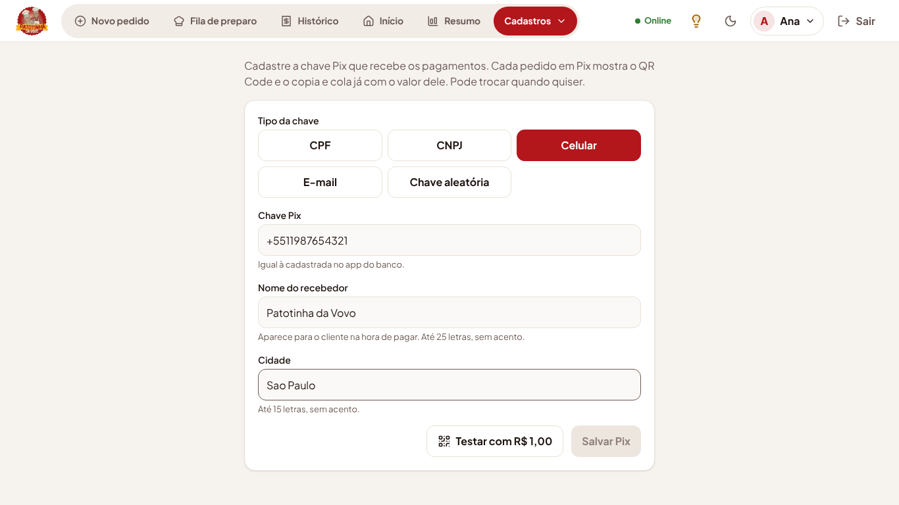

# Pix com o valor do pedido (etapa 13)

Adicionado em 19/10/2026, a pedido do Ryan: o pedido pago em **PIX** mostra um QR Code e o
**Pix copia e cola** já com o valor do pedido, para a chave Pix da Patotinha. A chave fica numa
tela editável, **Cadastros › Pix da loja**, e não no código.

## Como funciona no balcão

1. No **Novo pedido**, escolha **PIX**. Aparece o botão **Mostrar QR Code do Pix**.
2. A janela **Pagar com Pix** mostra o valor, o QR Code, para quem vai o Pix (nome e chave) e
   o código copia e cola.
3. O cliente lê o QR Code com o app do banco. Se preferir o código, **Copiar Pix copia e cola**
   copia o texto; no celular ou tablet, **Enviar o código** abre o compartilhar do aparelho
   (WhatsApp e outros).
4. **O sistema não confirma o pagamento sozinho.** Quem atende confere no app do banco se o
   Pix entrou e só então toca em **Finalizar pedido**.
5. No **Detalhe do pedido** de um pedido em PIX, **Mostrar o Pix deste pedido** abre de novo o
   QR Code com o valor, para quando o cliente for pagar depois.

Sem chave cadastrada, a janela avisa que o Pix ainda não foi configurado: o administrador vê o
link para a tela de configuração; os outros perfis veem "Peça ao administrador".

## Tela Pix da loja (só o Administrador)

- Em **Cadastros › Pix da loja** (no celular, em **Mais**).
- **Tipo da chave:** CPF, CNPJ, Celular, E-mail ou Chave aleatória. A chave é conferida conforme
  o tipo (dígitos do CPF e do CNPJ, celular com DDD, formato do e-mail e da chave aleatória) e
  guardada no formato do Pix: CPF e CNPJ só com números, celular com `+55`, e-mail e chave
  aleatória em minúsculas.
- **Nome do recebedor** (até 25 letras) e **Cidade** (até 15) aparecem para o cliente na hora
  de pagar. O Pix não aceita acentos, então "São Paulo" é gravado como "Sao Paulo".
- **Salvar Pix** vale na hora para todos os pedidos. Pode trocar a chave quando quiser.
- **Testar com R$ 1,00** mostra um QR Code de teste: leia com o app do seu banco e confira se o
  nome que aparece é o certo (não precisa pagar).

## Regras

- RN-P1: o código é um **Pix estático** no padrão BR Code do Banco Central (EMV), com chave,
  recebedor, cidade, valor do pedido e identificador. Não usa banco intermediário nem taxa.
- RN-P2: o valor do código é sempre o total do pedido na tela; mudar um item muda o código.
- RN-P3: identificador (aparece no extrato de quem recebe): `PEDIDO<número>` no Detalhe do
  pedido; `PATOTINHA` no Novo pedido, porque o número só existe depois de gravar.
- RN-P4: como não há confirmação automática, o pedido continua sendo finalizado pelo atendente,
  como nas outras formas de pagamento.
- RN-P5: só o Administrador muda o Pix da loja. Quem registra ou vê pedidos pode ler a chave
  (ela aparece para o cliente de qualquer jeito); o Chef não precisa dela.
- RN-P6: a chave não vai para os registros (logs) do servidor; só o tipo e quem mudou.

## Por que não um "link de pagamento"

Um link que confirma o pagamento sozinho precisa de um intermediário (Mercado Pago, PagBank,
Efí, a API Pix do banco), que cobra taxa por Pix recebido e pede conta e credenciais. O copia e
cola é o equivalente gratuito: dá para colar no app do banco ou mandar pelo WhatsApp. Se um dia
a confirmação automática valer a taxa, este é o lugar para trocar.

## Técnico

- Geração do código: `packages/shared/src/pix.ts` (`gerarPixCopiaECola`, CRC16-CCITT,
  `normalizarChavePix`, `esquemaConfigPix`). Testado com o exemplo do manual do BR Code
  (`pix.test.ts`). O código é gerado no aparelho; o QR Code também (biblioteca `qrcode`, em SVG,
  sempre preto no branco para qualquer celular ler, nos dois temas).
- Tabela `config_pix`, uma linha só (`id = 1`), migração `20261019000000_pix`. Sem a linha, o
  Pix não está configurado.
- API: `GET /api/pix` (Registrar pedidos ou Ver pedidos) devolve
  `{ configurado, tipoChave, chave, nome, cidade, atualizadoEm }`; `PUT /api/pix` (só
  Administrador) recebe `{ tipoChave, chave, nome, cidade }` e responde 422 `PIX_INVALIDO` com o
  campo errado em `detalhes`.
- Telas: `apps/web/src/componentes/JanelaPix.tsx` (janela do QR Code) e
  `apps/web/src/telas/cadastros/PixLoja.tsx`. Textos em `textos.pt-BR.json` › `pix`. Card do
  tutorial e lâmpadas do Novo pedido, Detalhe do pedido e Pix da loja em `ajuda/conteudo.ts`.
- Testes: `apps/api/test/pix.test.ts` (permissões, validação, gravação) e `e2e/pix.spec.ts`
  (aviso sem chave, cadastro pelo admin, QR Code e copia e cola com o valor do pedido).
