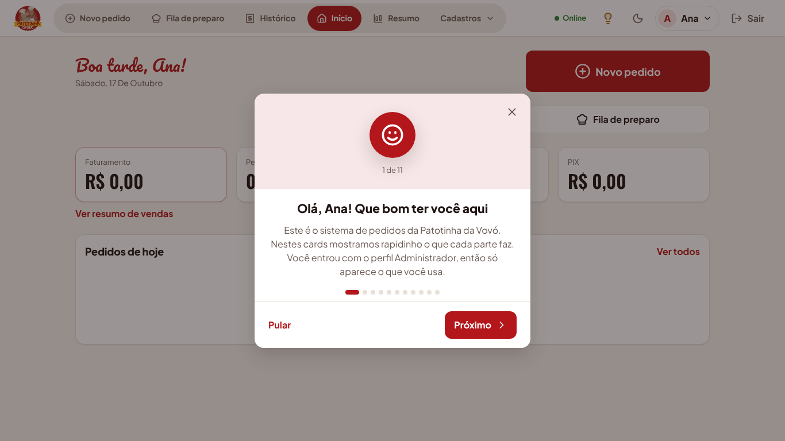
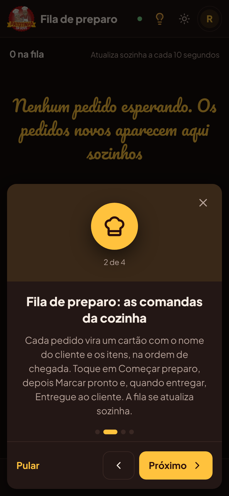
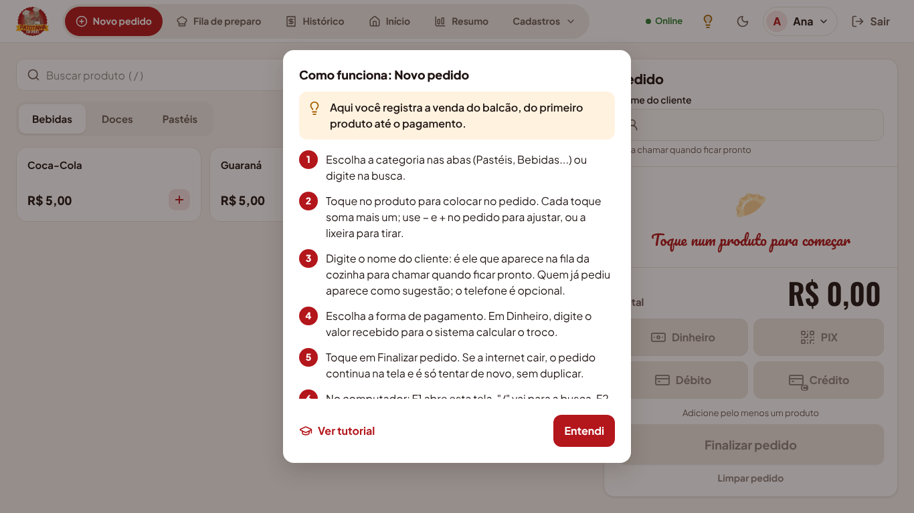
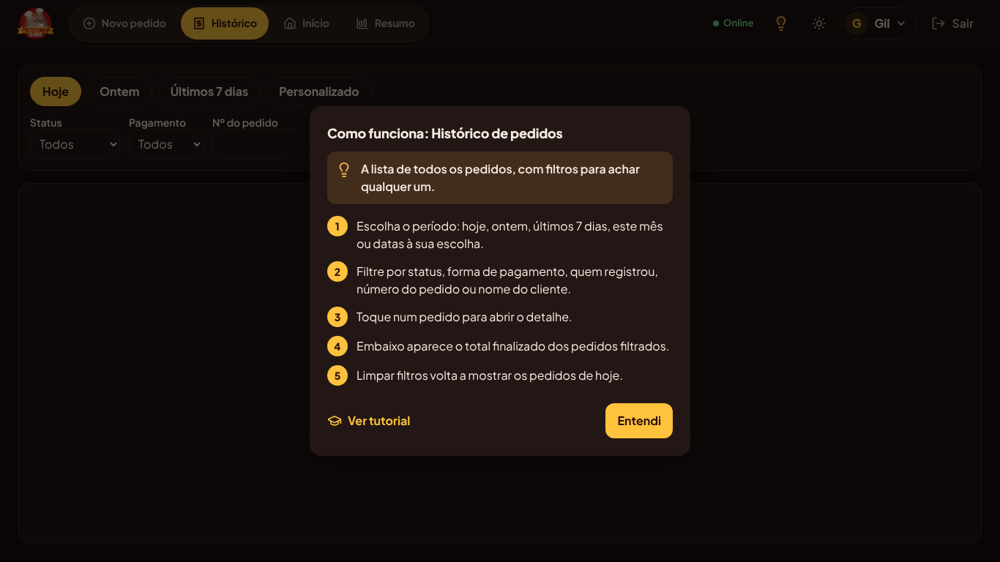

# Tutorial de primeiro acesso e lâmpadas de ajuda (etapa 12)

Adicionado em 17/10/2026, a pedido do Ryan: quem entra pela primeira vez vê cards explicando o
que cada parte do sistema faz, e toda tela tem uma lâmpada que explica o que fazer nela.

## Tutorial em cards

- Abre sozinho **uma vez por usuário**, logo depois do primeiro login. O servidor guarda que a
  pessoa já viu, então não volta a abrir em outro computador, tablet ou celular.
- Cada pessoa vê **só os cards das telas que o perfil dela abre** (ver [perfis.md](perfis.md)).
  De fábrica: Funcionário e Chef veem 4 cards, Gerente 7 e Administrador 12.

| Card                        | Quem vê                                  |
| --------------------------- | ---------------------------------------- |
| Boas-vindas (nome e perfil) | Todos                                    |
| Novo pedido                 | Registrar pedidos                        |
| Fila de preparo             | Fila de preparo                          |
| Histórico                   | Ver pedidos                              |
| Início                      | Ver pedidos ou Financeiro                |
| Resumo de vendas            | Financeiro                               |
| Cardápio                    | Cardápio                                 |
| Usuários                    | Usuários                                 |
| Perfis e permissões         | Só o Administrador                       |
| Pix da loja                 | Só o Administrador                       |
| No alto da tela             | Todos (conexão, Modo Claro/Escuro, menu) |
| Lâmpada                     | Todos                                    |

- Navegação: **Próximo** e **Voltar**, setas do teclado ou arrastar o dedo para o lado no
  celular. **Pular**, o **X** ou **Esc** fecham; no último card, **Começar a usar**. Fechar de
  qualquer jeito conta como visto.
- Para ver de novo: menu com o seu nome › **Ver tutorial**, ou **Ver tutorial** dentro da
  lâmpada.
- No celular os cards sobem de baixo; no computador ficam no meio da tela.

## Lâmpada de cada tela

- Botão de lâmpada no cabeçalho, ao lado da lua/sol, em todas as telas depois do login
  (Novo pedido, A receber, Fila, Histórico, Detalhe do pedido, Início, Resumo, Produtos, Categorias,
  Usuários, Perfis e Pix da loja). No celular também fica no cabeçalho.
- Abre a janela **"Como funciona: <tela>"** com uma frase sobre para que a tela serve e os passos
  numerados de como usar. Passos de coisas que o perfil não faz não aparecem (por exemplo, o
  passo de cancelar pedido só aparece para quem pode cancelar).
- Fecha com **Entendi**, Esc ou tocando fora.
- Cor âmbar nos dois temas (`aviso`), com contraste AA; o resto usa as cores de destaque do tema.

## Regras

- RN-T1: o tutorial abre sozinho só enquanto `tutorial_visto_em` do usuário estiver vazio.
- RN-T2: cards e passos seguem as permissões do perfil, com a mesma regra do menu.
- RN-T3: se a internet cair ao fechar o tutorial, nada trava; ele só abre de novo no próximo
  acesso.
- Usuários que já existiam antes desta mudança também veem o tutorial uma vez.

## Técnico

- Migração `apps/api/prisma/migrations/20261017020000_tutorial`: coluna
  `usuarios.tutorial_visto_em` (TIMESTAMPTZ, vazia = não viu). Roda sozinha no Render.
- API: login e `GET /api/auth/me` trazem `tutorialVisto`; `PUT /api/auth/tutorial` (qualquer
  usuário logado, corpo `{}`) grava a data da primeira vez e responde 204.
- Telas: textos dos cards e das lâmpadas em `apps/web/src/ajuda/conteudo.ts`; cards em
  `ajuda/Tutorial.tsx`; lâmpada em `ajuda/Lampada.tsx`; ligados no cabeçalho em
  `layout/Moldura.tsx`. Tela nova precisa de uma entrada em `AJUDA_TELAS` para ganhar lâmpada.
- Testes: `apps/api/test/auth.test.ts` › Tutorial de primeiro acesso e `e2e/tutorial.spec.ts`.
  Os usuários dos outros testes de ponta a ponta já entram com o tutorial visto.
